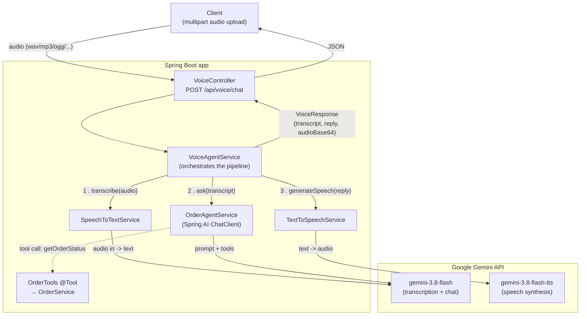
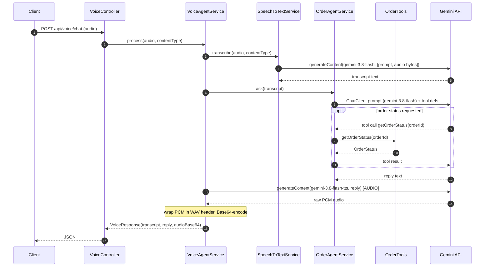

# springai-voice-agent

A voice-driven order assistant built with **Spring Boot 4** and **Spring AI 2.0**.

> User speaks to request order status → LLM converts voice into text → text request is passed to
> the LLM to get the status via the tool provided to the LLM → LLM returns the response text → LLM
> converts text to voice → finally, the voice response audio is delivered to the user.

The app runs fully on **Google Gemini** (free-tier Google AI Studio key), with an alternate
**OpenAI** profile.

---

## How it works

A single endpoint drives a three-stage pipeline: **speech-to-text → agent → text-to-speech**.



### Request sequence



---

## Components

| Component | Responsibility |
|---|---|
| [`VoiceController`](src/main/java/com/app/voiceagent/controller/VoiceController.java) | REST entry point. Accepts a multipart `audio` part and forwards it (plus its content type) to the orchestrator. |
| [`VoiceAgentService`](src/main/java/com/app/voiceagent/service/VoiceAgentService.java) | Orchestrates the STT → agent → TTS pipeline and assembles the response. |
| [`SpeechToTextService`](src/main/java/com/app/voiceagent/service/SpeechToTextService.java) | Transcribes audio by sending it to Gemini as a multimodal input via the Google GenAI SDK. |
| [`OrderAgentService`](src/main/java/com/app/voiceagent/service/OrderAgentService.java) | Runs the LLM agent through a Spring AI `ChatClient`. |
| [`TextToSpeechService`](src/main/java/com/app/voiceagent/service/TextToSpeechService.java) | Synthesizes speech via the Gemini TTS model and wraps the returned PCM in a WAV container. |
| [`OrderTools`](src/main/java/com/app/voiceagent/tool/OrderTools.java) / [`OrderService`](src/main/java/com/app/voiceagent/service/OrderService.java) | A Spring AI `@Tool` the model can call to fetch order status (currently stubbed data). |
| [`AiConfig`](src/main/java/com/app/voiceagent/configuration/AiConfig.java) | Builds the `ChatClient` with the system prompt, logging advisor, and tools. |
| [`GeminiClientConfig`](src/main/java/com/app/voiceagent/configuration/GeminiClientConfig.java) | Provides the raw Google GenAI SDK `Client` used by the audio services. |

---

## A note on the architecture: why two Gemini clients?

Spring AI's `google-genai` starter only provides a **`ChatModel`** — it has **no**
`TranscriptionModel` or `TextToSpeechModel` (those exist only for providers like OpenAI). So:

- **Chat** goes through Spring AI's `ChatClient` abstraction (tools, advisors, system prompt).
- **Speech-to-text and text-to-speech** bypass Spring AI and call the **Google GenAI Java SDK**
  (`com.google.genai`) directly, through the `Client` bean in `GeminiClientConfig`.

Both paths share the same API key.

---

## Tech stack

- Java 17
- Spring Boot 4.1.0 / Spring AI 2.0.0
- `spring-ai-starter-model-google-genai` (chat) + `com.google.genai:google-genai` SDK (audio)
- Google Gemini (`gemini-3.8-flash`, `gemini-3.8-flash-tts`)

---

## Configuration

The active provider is selected by Spring profile.

### `gemini` profile (default in use) — `application-gemini.properties`

| Property | Value | Used by |
|---|---|---|
| `spring.ai.model.chat` | `google-genai` | Routes chat to Gemini (disables OpenAI chat auto-config) |
| `spring.ai.google.genai.api-key` | `${GEMINI_API_KEY}` | Chat + audio SDK client |
| `spring.ai.google.genai.chat.model` | `gemini-3.8-flash` | `ChatClient` |
| `app.gemini.stt.model` | `gemini-3.8-flash` | `SpeechToTextService` |
| `app.gemini.tts.model` | `gemini-3.8-flash-tts` | `TextToSpeechService` |
| `app.gemini.tts.voice` | `Kore` | `TextToSpeechService` (prebuilt voice) |

### `openai` profile — `application-openai.properties`

Uses `spring-ai-starter-model-openai` with `OPENAI_API_KEY`. (The OpenAI starter is commented out
in `pom.xml` by default; re-enable it to use this profile.)

---

## Running

### Prerequisites

- JDK 17
- A **Google AI Studio** API key: https://aistudio.google.com/app/apikey

### Steps

1. Set the API key as an environment variable:

   ```bash
   # macOS/Linux
   export GEMINI_API_KEY=AIza...
   ```
   ```powershell
   # Windows PowerShell
   $env:GEMINI_API_KEY = "AIza..."
   ```
   > In an IDE, set `GEMINI_API_KEY` in the run configuration's environment variables — a value
   > set only in a terminal won't reach a run launched from the IDE.

2. Run with the `gemini` profile active:

   ```bash
   ./mvnw spring-boot:run -Dspring-boot.run.profiles=gemini
   ```

3. The app starts on `http://localhost:8080`.

---

## API

### `POST /api/voice/chat`

Multipart form upload of an audio clip.

| | |
|---|---|
| Content-Type | `multipart/form-data` |
| Part name | `audio` |

Example:

```bash
curl -X POST http://localhost:8080/api/voice/chat \
  -F "audio=@question.wav"
```

Response (`VoiceResponse`):

```json
{
  "transcript": "what's the status of order 123?",
  "response": "Order 123 has shipped and should arrive tomorrow.",
  "audioBase64": "<base64-encoded WAV audio>"
}
```

- `transcript` — what the model heard
- `response` — the agent's text reply
- `audioBase64` — the spoken reply as a Base64-encoded **WAV** (24 kHz, 16-bit mono PCM)

---

## Caveats

- **Input audio format:** Gemini accepts WAV, MP3, AIFF, AAC, OGG, or FLAC. The uploaded part's
  `Content-Type` must be set correctly (it's forwarded as the MIME type). Browser `MediaRecorder`
  defaults to `audio/webm`, which Gemini does **not** accept — record/encode to a supported format.
- **TTS output is WAV**, not MP3. If a frontend plays `audioBase64`, use the `audio/wav` MIME type.
- **Model availability:** Gemini model IDs change over time; if a call returns `404 ... no longer
  available`, update the model properties above to the current model.
